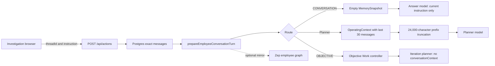

# Conversation memory audit — 29 October 2026

This is the historical audit of the pinned baseline below. The repair and its verification status are recorded separately in [conversation-memory-implementation.md](conversation-memory-implementation.md).

## Finding and revision

The reported loss of context is supported by the deployed source. CENTROPY has a
durable, private conversation transcript and some reference resolution, but no
operating chat compactor. It also does not consistently supply that transcript
to the model that answers or acts. The conversational route omits earlier
messages entirely. The planner route uses a 24,000-character context cap that
retains older loaded messages ahead of newer ones. Durable Objective iterations
do not receive the originating conversation context. These are distinct gaps;
model quality or an available integration cannot recover absent input.

Vercel reported READY production frontend deployment
`dpl_6n3spPRtMme61mmSbzbGG7Q2J3TX` and READY production API deployment
`dpl_D3bV93fMAYMriGxUjeKH9d6xvfnj`. Both identify Git commit
[`f80266f8e50356e8537bc3d4a4475a601225fc1e`](https://github.com/parammm390/finnor-ai/commit/f80266f8e50356e8537bc3d4a4475a601225fc1e)
on `main`. The source findings below refer to that commit. The local checkout
has additional edits and its provider-capture replay is labeled separately.
Deployment metadata does not establish which endpoint every user request
reaches or reveal the runtime configuration.

The audited path is authenticated CENTROPY Investigation chat through the OS
`POST /api/actions` endpoint. The public website's AI Concierge is a separate
endpoint.

## Failure modes to probe before writing the replay

1. The browser displays prior turns but does not pass the same thread ID on the
   next submission.
2. Turns persist, but the backend does not retrieve them for the model call.
3. A route retrieves context and then discards it before generation.
4. Context reaches prompt assembly, but fixed size limits drop older turns or
   important fields.
5. A summary field exists, but no writer advances its coverage cursor.
6. Short term memory requires a session ID the browser does not provide, or
   expires before the next turn.
7. Retrieval triggers only for narrow phrases, misses a relevant older turn,
   or returns a fact without enough provenance.
8. A background objective keeps Work state but loses the initiating conversation
   when its planner runs.
9. Model context is present, but the model fails to use it or mixes it with
   stale business data.
10. A test shows persistence or reference resolution without checking the
    actual model input and answer over 20–30 turns.

The evidence confirms modes 3–8 and 10 in the forms detailed below. It does not
establish mode 1 or 2 as the primary cause on the audited path. Mode 9 requires
model-output evaluation and was not measured. The replay captures local model
input; it cannot test production deployment, model behavior, or external
provider availability.

## Source path and causal findings

### Transcript storage is present; model access is inconsistent

The [frontend sends the selected `threadId` with each action](https://github.com/parammm390/finnor-ai/blob/f80266f8e50356e8537bc3d4a4475a601225fc1e/src/components/centropy/shell/CentropyWorkspace.tsx#L256-L305). The [API appends the user turn and passes prepared context to orchestration](https://github.com/parammm390/finnor-ai/blob/f80266f8e50356e8537bc3d4a4475a601225fc1e/finnor-os/apps/api/app/api/actions/route.ts#L210-L218), then [persists the assistant turn](https://github.com/parammm390/finnor-ai/blob/f80266f8e50356e8537bc3d4a4475a601225fc1e/finnor-os/apps/api/app/api/actions/route.ts#L381-L403). Postgres [loads the newest N messages and reverses them into chronological order](https://github.com/parammm390/finnor-ai/blob/f80266f8e50356e8537bc3d4a4475a601225fc1e/finnor-os/packages/db/index.ts#L2451-L2485). The conversation kernel [requests 30 exact recent messages](https://github.com/parammm390/finnor-ai/blob/f80266f8e50356e8537bc3d4a4475a601225fc1e/finnor-os/packages/orchestration/src/conversation-kernel.ts#L327-L373).

The UI can therefore show an accurate transcript while the model sees little or none of it. Thirty means individual user and assistant messages, not 30 user–assistant exchanges, and not a guarantee that all 30 fit a prompt. Older exact messages remain in Postgres and can be paged, but that is separate from whether a particular answer uses them.

### The conversational route starts from scratch

The [route classifier sends lightweight informational questions to `CONVERSATION`](https://github.com/parammm390/finnor-ai/blob/f80266f8e50356e8537bc3d4a4475a601225fc1e/finnor-os/packages/orchestration/src/instruction-routing.ts#L30-L79). The API has already prepared `conversationContext`, but the [orchestrator constructs an empty `MemorySnapshot`](https://github.com/parammm390/finnor-ai/blob/f80266f8e50356e8537bc3d4a4475a601225fc1e/finnor-os/packages/orchestration/src/index.ts#L770-L790). The [answer model's user payload contains only the new instruction, capability manifest, and `recentSession` derived from that empty snapshot](https://github.com/parammm390/finnor-ai/blob/f80266f8e50356e8537bc3d4a4475a601225fc1e/finnor-os/packages/orchestration/src/conversation.ts#L110-L146). `conversationContext` is accepted in responder options and used to classify a capability refinement; its message history is not placed in the answer payload. The system prompt forbids claiming business facts unless they appear in `recentSession`.

For the locally replayed question, “What did I say about the integration earlier?”, classification chose `CONVERSATION`, and the captured model user payload was exactly `{"instruction":"What did I say about the integration earlier?","capabilities":[],"recentSession":null}`. The current instruction is present; its earlier referent is absent. This explains a fresh-start symptom even before 20 messages. The deployed source confirms the same empty-memory structure; the exact replay ran against the local checkout.

### The planner can drop the newest context first

The planner receives `conversationContext` in [OperatingContext](https://github.com/parammm390/finnor-ai/blob/f80266f8e50356e8537bc3d4a4475a601225fc1e/finnor-os/packages/orchestration/src/operating-context.ts#L488-L500). Its [prompt assembly](https://github.com/parammm390/finnor-ai/blob/f80266f8e50356e8537bc3d4a4475a601225fc1e/finnor-os/packages/orchestration/src/planner.ts#L142-L192) imposes a **24,000-character** JSON budget on the entire operating-context field. `boundedPromptValue` traverses object fields and array entries in insertion order, keeping the prefix that fits. It reserves no space for the newest correction, the immediately previous answer, or later fields such as canonical summaries, epistemic warnings, integration health, authority, sources, and health. `conversationContext` precedes those fields.

Because Postgres returns the last 30 messages in chronological order, an overflowing prompt retains the **oldest of those 30 first**. A recent correction can disappear while an older assumption remains. In a local provider-capture replay using the actual local `LLMPlanner`, 30 synthetic messages with 40 filler characters each all survived in a 12,061-character operating context. With 1,200 filler characters each, only markers 1–15 survived in a 23,981-character operating context. Marker 29 (previous assistant) and marker 30 (current user's history entry) were absent, as were the later fields named above. The current instruction still reached the model separately. The local checkout adds a small `beliefViews` field absent from the production planner source, so these marker counts are illustrative local observations, **not** production measurements. The 24,000-character budget and prefix-truncation mechanism are confirmed in deployed source.

This is a character limit inside one prompt field, distinct from the model's published token window. Its actual cutoff depends on message lengths, JSON metadata, other context fields, and redaction.

### The summary schema has no operating compactor

The [thread schema declares nullable `summary` and `summaryThroughSequence` defaulting to zero](https://github.com/parammm390/finnor-ai/blob/f80266f8e50356e8537bc3d4a4475a601225fc1e/finnor-os/packages/db/schema.ts#L1217-L1228). The [DB update method can write both](https://github.com/parammm390/finnor-ai/blob/f80266f8e50356e8537bc3d4a4475a601225fc1e/finnor-os/packages/db/index.ts#L2563-L2595). The kernel [reads an existing summary if one is there](https://github.com/parammm390/finnor-ai/blob/f80266f8e50356e8537bc3d4a4475a601225fc1e/finnor-os/packages/orchestration/src/conversation-kernel.ts#L346-L372), but its three calls to the updater write references, Work IDs, and outcome references, never a summary or coverage cursor. Repository-wide search at the deployed commit found no other runtime writer of `summaryThroughSequence`; matches were the schema, DB loader and setter, frontend contract, and kernel reader. No compaction trigger, summary generation, or repeated summary update was found on this path. This is the direct answer to why the “compaction part” is not working: the field exists, but the process that would populate and advance it is absent.

The [generic memory snapshot sets `longTerm` to null](https://github.com/parammm390/finnor-ai/blob/f80266f8e50356e8537bc3d4a4475a601225fc1e/finnor-os/packages/memory/src/snapshot.ts#L17-L52); it accepts a `canonicalThreadId` option but does not use it. The [planner-memory helper reads `longTerm.canonicalSummary` only when `PLANNER_MEMORY=1`](https://github.com/parammm390/finnor-ai/blob/f80266f8e50356e8537bc3d4a4475a601225fc1e/finnor-os/packages/orchestration/src/planner-memory.ts#L18-L20), yet this snapshot supplies no such object. That flag controls an additional memory prompt field; it does not activate conversation compaction.

### Redis and Zep do not close these gaps

The [frontend sends `threadId` but no `sessionId`](https://github.com/parammm390/finnor-ai/blob/f80266f8e50356e8537bc3d4a4475a601225fc1e/src/components/centropy/shell/CentropyWorkspace.tsx#L284-L298). The [snapshot reads Redis short-term memory only when both employee and `sessionId` exist](https://github.com/parammm390/finnor-ai/blob/f80266f8e50356e8537bc3d4a4475a601225fc1e/finnor-os/packages/memory/src/snapshot.ts#L17-L21). Redis stores at most 20 entries with a 30-minute TTL. The planner helper exposes at most six, and only for a reference-like or short clarification instruction. Thus this browser path has no normal session-keyed Redis continuity to rescue the conversational answer route.

The [Zep mirror is optional, best-effort, and absorbs write and search errors](https://github.com/parammm390/finnor-ai/blob/f80266f8e50356e8537bc3d4a4475a601225fc1e/finnor-os/packages/memory/src/consolidated.ts#L65-L131). The kernel requests [five employee-graph facts](https://github.com/parammm390/finnor-ai/blob/f80266f8e50356e8537bc3d4a4475a601225fc1e/finnor-os/packages/orchestration/src/conversation-kernel.ts#L327-L371), but the conversational answer model never receives `zepFacts`. Without a Zep key, or on provider failure, the result is empty. Even when Zep works, retrieved fact text is not an exact reconstruction of a 30-message task and its action status. The current `zepFacts` context entries carry fact text, source label, and optional time, but not canonical source-message IDs.

The [historical exact-message search](https://github.com/parammm390/finnor-ai/blob/f80266f8e50356e8537bc3d4a4475a601225fc1e/finnor-os/packages/orchestration/src/conversation-kernel.ts#L101-L133) is narrower: it fires for extracted human or party names after expressions such as “spoke to,” “talked with,” or “met.” A broad “what did I say about the integration?” question does not trigger it. Personal-memory storage has a DB method, but repository search found only its definition and integration-test references, no ordinary runtime call that automatically captures user corrections or preferences.

### Durable Objectives retain Work state without the prior chat

For `OBJECTIVE`, the [orchestrator starts an Objective without `conversationContext`](https://github.com/parammm390/finnor-ai/blob/f80266f8e50356e8537bc3d4a4475a601225fc1e/finnor-os/packages/orchestration/src/index.ts#L754-L768). The [Objective options type has no conversation-context field](https://github.com/parammm390/finnor-ai/blob/f80266f8e50356e8537bc3d4a4475a601225fc1e/finnor-os/packages/orchestration/src/objective-loop.ts#L357-L370). In an iteration the [controller assembles context with memory disabled and passes `EMPTY_OBJECTIVE_MEMORY`](https://github.com/parammm390/finnor-ai/blob/f80266f8e50356e8537bc3d4a4475a601225fc1e/finnor-os/packages/orchestration/src/objective-loop.ts#L2682-L2704). It does supply objective text, canonical inspection, and active Work context. An earlier conversational constraint that was not encoded in those structures is therefore unavailable merely because it appeared in the same Investigation chat. Source alone cannot establish how any particular Objective behaved.

### Google integration is a separate surface

The deployed frontend has a [public `/api/ai-concierge` endpoint](https://github.com/parammm390/finnor-ai/blob/f80266f8e50356e8537bc3d4a4475a601225fc1e/src/app/api/ai-concierge/route.ts#L1-L50) that accepts visitor-provided messages, [retains only the last 12](https://github.com/parammm390/finnor-ai/blob/f80266f8e50356e8537bc3d4a4475a601225fc1e/src/app/api/ai-concierge/route.ts#L88-L105), then [tries Groq and Gemini](https://github.com/parammm390/finnor-ai/blob/f80266f8e50356e8537bc3d4a4475a601225fc1e/src/lib/llm/concierge.ts#L140-L199). That visitor and lead-guidance route is separate from authenticated CENTROPY Investigation `POST /api/actions`. The public route has no compactor either. Gemini availability, or Google integration elsewhere, does not place previous Investigation messages into the OS answer model's payload.

## Verification and evidence limits

The deployed [Phase 6 integration test](https://github.com/parammm390/finnor-ai/blob/f80266f8e50356e8537bc3d4a4475a601225fc1e/finnor-os/tests/integration/phase6-conversation-context-kernel.test.ts) checks idempotent persistence, employee isolation, reference resolution, Work links, explicit-memory supersession, and one named-reference search beyond 100 messages. It is guarded by `describe.skipIf(!available)` for its DB prerequisite. Those checks support storage and narrow retrieval. They do not assert that the actual model request contains 20–30 messages, that a summary is generated, that repeated compaction preserves an early constraint, or that a final answer or action honors a later correction. This audit did not run that DB suite or an authenticated production transcript test.

The [local prompt replay](conversation-memory-replay-2026-10-29.jsonl) can be repeated with `cd /Users/paramdave/FINNOR/finnor-os && ./node_modules/.bin/tsx scripts/audits/replay-conversation-prompt.mts`. The [script](../scripts/audits/replay-conversation-prompt.mts) uses artificial messages and a capturing provider, so it records actual *local* planner and responder model input without calling a remote model. It is an isolation diagnostic, not end-to-end qualification. The recorded failure modes above were written before this replay, per the repository's isolation-testing rule.

The separate [primary-source research note](conversation-memory-research-2026-10-29.md) reviews LongMemEval, LoCoMo, Lost in the Middle, RULER, NoLiMa, multi-turn degradation, repeated context rewriting, summary factuality, and first-party compaction guidance. The evidence separates four failure stages: source material absent, relevant evidence not retrieved, evidence present but read incorrectly, and final artifact or action inconsistent with evidence. FINNOR has confirmed source-to-model delivery gaps. The research does not support a universal “30 messages means perfect recall” threshold or allow a model capability claim to substitute for a recorded end-to-end trace.

The requested 20–30-message quality claim would require the counting unit, actual prompt budget, model identifier, compaction event, model-visible evidence, answer or action, and source-grounded expected outcome to be recorded. Thirty short messages with no compaction event cannot qualify compaction. A system that recalls one named entity but loses a later correction, unresolved decision, or verification status does not meet the stated bar. These are evaluation criteria from the research, not a claimed FINNOR pass or a proposed replacement architecture.

| Status | What is established |
| --- | --- |
| Confirmed in deployed source | Thread ID forwarding and persistence; empty conversational memory payload; 30-message context load; 24,000-character prefix truncation; no runtime summary writer found; browser session-ID mismatch; Objective iteration without conversation context; separate 12-message public Concierge. |
| Observed in local replay only | Exact 30-of-30 versus 15-of-30 marker counts and the model payload for the quoted recall question. Production has a closely related but not identical planner file. |
| Unmeasured | A real production user's request trace, Zep and Redis runtime configuration and health, selected answer model and its window, production answer correctness, and any statistical retention rate. No authenticated chat was modified. |

The source-level verdict is strong for **why context can vanish** and deliberately limited for **how often it vanishes in production**.
