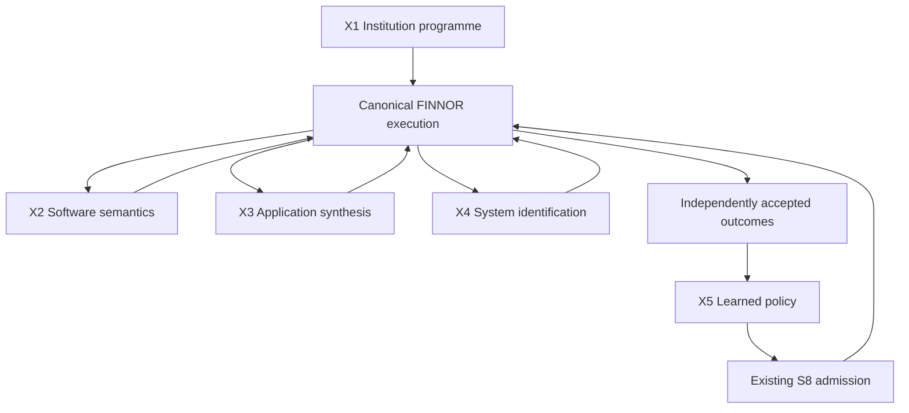

FINNOR FRONTIER-5 — Executable institution PRD and Factory mission
Revision: 2.0.
Date: 11 October 2026, Asia/Kolkata.
Status: Proposed product, engineering, research and qualification contract. No implementation or performance result is claimed.
Planning position: Incremental over completed, independently qualified S/P/M/R/V. The implementation must identify the actual checkout and prove that intended baseline before assigning an incremental multiplier.
Scope identity: Exactly five product phases, FRONTIER5.X1–X5. These replace the earlier mission's mechanisms and acceptance conditions while retaining its five digital outcome classes.

The programme changes FINNOR's unit of work. A firm gives an authorized institutional mandate; FINNOR reconstructs the relevant operating structure, turns unfamiliar software into composable operations, manufactures missing applications, identifies unknown system behavior and compiles verified experience into reusable execution policies. These outputs become executable assets consumed by the existing FINNOR runtime.

The target is 100 times the independently accepted material business work of qualified post-V FINNOR under matched resources and authority. This is a programme acceptance requirement in Section 9, not a descriptive adjective. Component qualification alone cannot satisfy it.

The design uses frontier intelligence to discover and construct durable computational assets, then reuses those assets while their validity holds. It must not repeatedly spend human interpretation, application integration and general-model reasoning on an already established problem. New evidence, new rights or a changed environment invalidate the relevant asset and reopen only the affected work.
1. Five scope register
Phase	Fundamental engineering change	Principal output	New capability boundary
X1 — Institutional Programme Compiler	Compile authorized institutional evidence and standing mandates into an incrementally executable operating programme.	InstitutionProgram	The firm can supply sources and responsibility rather than manually defining every ontology mapping and workflow invocation.
X2 — Software Semantics Compiler	Infer an unfamiliar application's operational semantics and compile a reusable, guarded operation algebra.	ApplicationActionModel	Previously unknown software becomes a native planning/execution capability without a human-built connector for each application or task.
X3 — Enterprise Application Synthesizer	Compile a business requirement into complete software whose critical behavior is bound to independently checkable contracts.	EnterpriseApplicationPackage	FINNOR supplies missing enterprise software and maintains it through changed requirements, data and dependencies.
X4 — Autonomous System Identification	Actively distinguish competing explanations of an unknown digital mechanism and establish an executable predictive relationship.	IdentifiedSystemModel	FINNOR acquires operational knowledge through permitted experiments and uses it to choose better interventions.
X5 — Experience-to-Policy Compiler	Distill independently accepted experience into admitted executable policies and trained components with fresh-transfer and retention proof.	LearnedPolicyCapsule	Work produces reusable computational capability; future work can execute through the learned asset rather than restart general reasoning.

These are five transformations, not five agent teams. X1 compiles institutional state/responsibility. X2 compiles operations. X3 synthesizes products. X4 identifies mechanisms. X5 compiles learned execution. Each owns one output and one falsifiable claim.
1.1 One concrete product consequence
A partner assigns a standing mandate to maintain investment-decision readiness across admitted deals, evidence, counterparties, obligations and approvals.

The firm connects its approved sources and existing grants. FINNOR reconstructs the relevant operating model, maintains an executable responsibility programme and recognizes a material dependency change. Required work now depends on an unfamiliar portal and a missing reconciliation application.

FINNOR learns the portal's operational semantics, constructs the reconciliation product, discovers an undocumented mechanism that makes an apparently complete export incomplete, and finishes the permitted work with independently observed postconditions. It then compiles the successful method into an admitted policy capsule.

A second firm or differently structured application supplies fresh objects, permissions and workflow conditions. FINNOR transfers the method without copying the first firm's private facts, bypassing authority or receiving a task-specific human patch. If transfer assumptions fail, it identifies exactly which asset must be revised.

The user sees the institutional obligation, its current evidence, the executable plan, the manufactured software, the learned operation and the established result in the existing Work experience. The user does not need to reconstruct this chain from five chat transcripts.
1.2 Why this is a larger programme than the previous mission
Earlier limitation	Binding replacement
Awareness could be a configured watcher feeding an existing task.	X1 must infer the declared operating model and generate responsibility-driven continuation; no manually mapped institutional template may be required for held-out firms.
Software mastery could be a collection of successful browser traces.	X2 must deliver composable operation semantics, use them for new workflow compositions, and detect when an operation's validity changes.
Product creation could pass on several generated applications.	X3 must synthesize from independently specified business invariants, prove installed behavior and carry out data-preserving lifecycle changes.
Discovery could be one useful experiment about an export.	X4 must learn an unknown mechanism class, distinguish confounded explanations and transfer the identified model to withheld interventions.
Learning could be a prompt change plus a modest training result.	X5 must create executable learned assets, demonstrate generalization, measure amortized execution economics and prove an actual parameter contribution.
A scope could pass with a 2× work improvement.	There is no 2× substitution for the programme target. All five engines can qualify while the 100× programme remains UNPASSED.
Twenty episodes could be reported as a generational system result.	Integrate across independently administered institutions, workload strata and sustained fault-injected operation; report the exact population supported.
Factory workers could quietly supply FINNOR's missing intelligence.	All scored work must be performed by the delivered FINNOR runtime. Build workers may repair product code outside scored runs; rescue inside a run remains assisted failure.

The new names identify the computational changes. Renaming an existing controller, adding types around it or increasing a test count does not establish any of the changes above.
1.3 What the 100× target requires structurally
The programme must remove recurring human construction and interpretation from the critical path, and it must produce materially more completed work within the same total envelope.

A tenfold cheaper model invocation does not satisfy this requirement if integration, confirmation or human approval dominates the end-to-end result. A system that performs the same work faster also needs a saturated, registered workload to demonstrate the requested capacity expansion.

Before committing to implementation, measure the incumbent's actual limiting terms: institutional onboarding, unfamiliar-application integration, product construction, unanswered operational questions, per-assignment reasoning, mandatory approvals, failures and recovery.

Allocate each proposed mechanism to the measured term it changes. If the model demonstrates that the unchanged terms cap the attainable result below 100×, change the design or report the unmet requirement. Do not revise the number to fit the implementation.
2. Baseline, domain and canonical ownership
2.1 Three baseline manifests
Freeze B_live, the actual implementation checkout and active capabilities; B_V, completed and qualified S/P/M/R/V; and B_ref, appropriately equipped alternative implementations used for specific engineering comparisons.

B_live is a current-state record. It is not a substitute for B_V when claiming an incremental 100× over the intended post-V system. A proposed V capability does not become an incumbent result through a manifest entry.

Each record binds source commits, dirty-tree identity, schema/migration boundaries, dependencies, model/provider versions, tools, preparation, rights, grants, resources, runtime configuration and measured qualifications. Preserve historical R comparisons and the original principal financial protocol.

The inspected reference repository is parammm390/finnor-ai at 517003a4396bc8101a90be4b425ee01de9446740. This is limited source grounding, not an audit of every line, the latest local branch or the production installation.
Existing surface	Inspected boundary	Required treatment
tools/src/source-adapters.ts	Provider observations are separated from domain truth mapping.	X1 consumes retained evidence through the canonical semantic owner; an observed provider field does not automatically become a business fact.
workflow-runtime/src/index.ts	Durable command, inbox/outbox, receipt, reconciliation and operator-control exports use the existing runtime.	Compile X outputs into existing work/effect machinery; no competing workflow engine or business ledger.
computer/src/index.ts	Computer-use contracts, provider, broker, repository and runner exports.	X2 extends the actual execution boundary after tracing its callers and effect semantics.
artifacts/src/index.ts	Artifact creation, publication, recalculation and document/spreadsheet/presentation services.	Reuse appropriate lifecycle services; document generation alone does not establish X3 application construction.
authority/src/index.ts	Tenant-scoped role, resource, grant and authority-revision handling.	All inferred responsibilities and generated products remain subject to current authority.
capability-evolution/src/contracts.ts	The inspected ordinary revision schema targets S5 allocation methods.	X2/X3/X5 need explicit reviewed domain adapters if present S8 contracts remain constrained. Never mislabel arbitrary payloads as allocation methods.

Paths above are relative to finnor-os/packages. Recheck actual implementations, dependencies and current instructions before designing file changes. All new interface names in this PRD are proposed logical contracts.
2.2 First admitted institutional domain
The first profile is a PE-firm operating environment, covering institutional work across deal evidence, decision readiness, obligations, financing/transaction records, approvals and selected firm administration. Portfolio-company operation is outside this profile.

The source population includes permissioned financial/document systems, CRM/work tracking, email/calendar, approval systems, browser-only portals and selected HR/benefit/expense records where consent, role and data access permit them. The compiler may discover relations; it cannot infer permission to access sensitive records.

Fix the exact source classes, user roles, workflow families, concurrency, data scale, effect types and oracle coverage in a DigitalInstitutionProfile. A previously unseen instance within a supported class differs from an entirely unsupported application protocol, business jurisdiction or fiduciary activity.

“No manually defined operating model” does not mean “no mandate, permissions or business authority.” The owner supplies the institutional objective and grants. FINNOR must establish the remaining supported structure from evidence or leave it unresolved.
2.3 Frozen ownership
Owner	Retained responsibility
S1 / P4	Evidence, identity, beliefs, rights, contradiction handling and temporal truth.
S2	Experiment assignment, admissibility, exposure and measurement contracts.
S3	Identification, competing mechanisms, causal claims and transport validity.
S4 / P1	Policy/action/wait/stop semantics, mandate binding and durable programme progression.
S5 / P2/P3	Resource feasibility, reservations, isolation and bounded computational execution.
S6 / P5	Current authority, exact effect identity, settlement, UNKNOWN outcomes and reconciliation.
S7	Costs, realized outcome accounting and economic attribution.
S8	Independent evaluation, typed-domain admission, promotion, revocation and rollback authority.
P7	Revision dependencies, invalidation and continuation.
V5	Authorized shared Work/focus, consequence-aware inspection and operator intervention.

The programme extends these owners. A compiler does not acquire an enforcement role simply because it emits code.
2.4 Preserve the financial qualification contract
The current V document retains the following R gates. They remain applicable wherever an X capability enters the corresponding financial decision path.
Frozen item	Required retained gate
Goal/correctness	≥95% under the original oracle, scoring and confidence basis.
Decision loss	Normalized expected regret or valid reference-policy shortfall ≤0.05.
Forecast calibration	Coverage error ≤0.02 at 50/80/90/95%; mean 90% interval width ≤0.5 of the fixed outcome range.
Financial episode	$100 total compute/data/integration; 900 human seconds; 16 GiB aggregate simultaneous peak; 30-second initial response; 3,600-second wall limit.
Reach/generator	Preserve 90 operational days, 100 companies/deals, ten system types, 1,000 concurrent missions, 10,000 interacting decision opportunities and the frozen generator coordinates.
Money	Preserve the $100 million additional net owner-value objective and original attribution/comparator definitions; H2 is the registered 36-month mature horizon.

Compilation, simulation, training and multiweek institutional work need separately registered aggregate envelopes. Their costs cannot be hidden by resetting descendant financial episodes.
2.5 Independence of fact, model and execution
An authenticated record establishes which source supplied which bytes. It does not establish that the source's business assertion is correct.

An inferred institutional relation remains an inference. A learned transition is a prediction with a domain. A reproduced experiment supports a specific finding. A synthesized policy is a candidate. An independently observed external postcondition supports an execution result.

Preserve these distinctions even when the UI uses a simple label. No model-generated success, generated document, trained reward, simulated balance or agent consensus may overwrite the authoritative status.
3. Common executable contracts
3.1 FrontierArtifactEnvelope
FrontierArtifactEnvelope {
  artifact_id, kind, schema_revision, content_digest
  tenant_ref, work_ref, institutional_program_ref
  parent_artifact_refs, producer_revision, baseline_manifest_ref
  authority_grant_ref, rights_revision, resource_grant_ref
  source_refs, source_revision_vector, knowledge_cut
  admitted_domain_ref, application_fingerprints
  model_refs, dependency_lock_digest, runtime_digest
  observed_claims, inferred_claims, predicted_claims, unresolved_claims
  postcondition_contract_refs, independent_check_refs
  S6_obligation_refs, provider_observation_refs
  invalidation_dependencies, lifecycle_state, lifecycle_events
  build_learning_compute_cost_refs, attributable_human_work_refs
}
Bind amounts to currency, entity, time and accounting basis. Bind identities to their source/institution context. Bind operations to the actual application version, role and state. An amount read from a screen without a currency or date cannot certify a financial obligation.

Principal outputs are versioned assets in existing canonical storage. Evidence bodies may live in rights-controlled object storage; compact projections may live in the existing database. Neither creates a second institutional truth authority.
3.2 The operation contract
Every effectful candidate operation binds inputs, current preconditions, external postconditions, effect class, supported authority, resource bounds and the observation method.

Compile the proposal through existing S4/S5/S6. Final dispatch rechecks grants, relevant evidence revisions and the application's actual starting state. Admission to an operation domain grants no execution authority.

For response loss after a submission, preserve the same obligation identity and mark the effect UNKNOWN. Query admissible external state; do not resubmit under a fresh identity. If the application cannot distinguish duplicate from missing completion, retain the unresolved outcome and exposure.

A learned driver cannot promise idempotence that the external application does not support. Identify operations whose ambiguity requires human or provider reconciliation before replay.
3.3 Compiler versus evaluator versus authority
Compilers propose artifacts. Independent checkers evaluate specified properties. Existing protected owners admit capabilities and authorize effects.

The builder cannot alter the business objective, expected postconditions, authority policy, evaluator code, hidden truth, measurement instrument or promotion record to make a candidate pass. Source-level accessibility or prompt instructions alone do not protect an oracle.

Use separate validator credentials and process/filesystem boundaries where required. The scored runtime has no access to hidden oracle state. If custody cannot be established, evidence remains development evidence and the corresponding protected gate is blocked.
3.4 Invalidation and continuation
Every executable asset carries a validity dependency set. Changes to a relevant source revision, application semantics, mandate, grant, model, data schema or runtime invalidate the affected assumption.

Recompute the smallest sound dependency closure. Preserve original results and cost. A new artifact revision cannot erase the episode that falsified its predecessor.

Not all changes invalidate everything. A portal's visual theme change may leave API semantics intact; a changed confirmation meaning may invalidate the operation even when its screen layout is unchanged. The actual validity checker must establish the distinction.
3.5 Independent measurement interfaces
Qualify facts and operations against externally administered records, provider readback, persisted state and pinned business invariants. Keep both the starting state and ending state, including failures and intermediate effects.

A contract oracle states what constitutes completion before implementation. Learned application semantics do not automatically define the external success criterion. Expected values cannot come from the function under test or a mock that performs the asserted behavior.
4. X1 — Institutional Programme Compiler
4.1 Outcome and computational boundary
An unfamiliar firm supplies authorized sources, current grants and a standing responsibility. It does not supply a manually constructed institutional ontology, source-to-domain mapping or process diagram.

FINNOR reconstructs the relevant operating structure and compiles that responsibility into an executable programme over canonical objects. The programme continues through source changes, deadlines, interruptions and personnel changes using existing S4/S6 execution.

The breakthrough being tested is institutional evidence to executable responsibility. An imported knowledge graph, a configured polling loop or a model explaining the organization does not satisfy it.

The owner still defines the responsibility, materiality, risk tolerance and authority. Past behavior is evidence about a process, not permission to repeat it.
4.2 Principal production output
InstitutionProgram {
  envelope: FrontierArtifactEnvelope,
  mandate_ref,
  inferred_source_mapping_refs,
  canonical_entity_and_relation_refs,
  temporal_and_unit_constraints,
  obligation_derivation_rules,
  materiality_and_priority_contract,
  unresolved_interpretations,
  evidence_dependency_graph,
  incremental_update_rules,
  s4_programme_ref,
  s6_obligation_refs,
  validity_and_invalidation_contract,
  independently_checked_model_revision
}
The artifact refers to S1-owned facts and S4-owned programme semantics. It cannot create its own authoritative copy of the firm.

An obligation derivation binds the triggering evidence, applicable condition, deadline, responsible principal, permissible action class and independent completion observation. Unresolved identity, units, rule meaning or authority must remain explicit.
4.3 Required computation
1. Read authorized observations with original identifiers, timestamps, provenance, permission context and retained raw evidence.
2. Propose entity correspondence, temporal relationships and process hypotheses. Preserve alternatives where evidence is insufficient.
3. Check proposed mappings against independent invariants: identity collisions, impossible chronology, conservation/accounting relationships, explicit source rules and contradictory observations.
4. Admit supported mappings through the existing semantic owner. Refer uncertain mappings for bounded interpretation; count all resulting human work.
5. Compile the supplied responsibility into existing policy/programme representations using only established facts and admitted operations.
6. Incrementally maintain the dependency closure as observations change. Recognize new obligations, invalidate affected assumptions and re-evaluate already prepared actions.
7. Execute within standing authority and reconcile actual outcomes. Escalate a missing decision or permission with the exact unresolved condition.
Process discovery and constraint solving may contribute to this computation. Observed correlations cannot silently become a firm's normative operating rules. A model may infer that approval usually precedes a payment; the applicable authority contract determines whether that approval is required.
4.4 Qualification profile
The first protected population comprises ten previously unseen institutional environments, each containing at least eight heterogeneous system classes, independently annotated material entity relationships, responsibilities and contradictory records.

Randomize identifiers, schema organization, date conventions, permissions and process variants. Hold back the ground-truth mappings and obligation ledger. An institutional environment is not unseen merely because its company name changed.

For each environment:
- Supply the owner mandate, source access and authority envelope.
- Permit the same bounded exploration and clarification resources to candidate and comparator.
- Provide no institution-specific mapping or workflow code to the candidate.
- Run a 30-day replay containing changing obligations and fault conditions; separately run a seven-day unattended application soak against live test services.
- Include existing FINNOR-native operations so that X1 can qualify without depending on unfinished X2–X5.
The replica clock and live clock are reported separately. Replaying thirty days in an hour does not prove thirty days of live durability.
4.5 Decisive fixture
A firm has two funds, several deal entities, one lender portal, overlapping employees and conflicting company names across systems. Its mandate is to maintain decision-readiness and specified approval obligations.

A lender changes the meaning of a reporting field. One employee loses authority. A refreshed file corrects a previously relied-on financial number. A later email requests an exception but does not itself grant it.

The delivered programme must identify the affected objects and obligations, withdraw stale readiness, preserve unaffected work, request the missing authorized decision and continue the allowed responsibilities. It must not approve an exception because similar exceptions were approved historically.

The independent oracle inspects canonical state, provider records, standing responsibilities and final S6 effects. A useful explanatory summary without correct programme behavior fails.
4.6 Protected gates
Claim	Required observation
Institutional reconstruction	At least 99% precision and 95% recall on preregistered material entity/relationship mappings, with per-environment results reported.
Responsibility reconstruction	At least 99% precision and 95% recall on the independently annotated obligations supported by the supplied mandate and evidence.
Material contradictions	No tested material contradiction may be silently converted into a settled fact or executable decision.
Continuous continuation	At least 95% of supported obligations completed within their contractual deadlines; all missed, blocked and unknown obligations accounted for.
Change handling	At least 95% of actionable changes recognized within 120 seconds of their availability through the admitted observation channel; source transport delay is measured separately.
Construction independence	No institution-specific human schema mapping or workflow patch during scored runs. All clarification and supervision time remains in the denominator.
Authority and recovery	No observed unauthorized effect, cross-tenant disclosure, stale-grant execution or false completion across the protected adverse cases.

A missed material obligation can invalidate domain qualification even if average mapping scores pass. Freeze critical-case categories before runs.

X1-specific falsifier: The system needs an engineer to teach it the held-out firm's operating mappings, or it merely produces descriptions that a human must turn into workflows.
5. X2 — Software Semantics Compiler
5.1 Outcome and computational boundary
FINNOR encounters a previously unfamiliar authorized application. It learns a bounded set of operations from interaction evidence, compiles their semantics and completes fresh compositions without a human-written integration for that application.

The learned object is an operation algebra: actions can be composed because their typed inputs, state predicates, effects and postconditions are understood within an admitted domain.

This crosses black-box software to reusable executable interface. A recording that succeeds only for the demonstrated screen sequence is insufficient.

“Universal” names the acquisition mechanism. Actual release coverage remains the admitted application/state/operation domain. Unsupported MFA, inaccessible state, prohibited exploration or unknown confirmation semantics must remain unsupported.
5.2 Principal production output
ApplicationActionModel {
  envelope: FrontierArtifactEnvelope,
  application_identity_and_version_evidence,
  observable_state_schema,
  operation_signatures,
  parameter_and_unit_constraints,
  precondition_predicates,
  effect_and_obligation_contracts,
  postcondition_observers,
  transition_model_and_uncertainty,
  compositional_rules,
  permitted_exploration_record,
  drift_detectors,
  held_out_execution_evidence,
  supported_domain
}
Each consequential operation includes the S6 effect identity, required grant, permitted scope, reconciliation path and behavior when the provider outcome is unknown.

Observed interface behavior is not a substitute for an external system's policy or legal meaning. A button labelled “approve” does not establish the authority to approve.
5.3 Required computation
Acquire accessible interface structure through the most reliable permitted surface: published API, document structure, accessibility information, ordinary UI or visual observation. Use the existing broker and provider boundaries.

Explore only the admitted test environment or operations covered by current authorization. Learn the distinction between navigation, preparation, state changes and externally consequential commitment.

Infer parameterized transitions rather than memorizing literal selectors and records. Separate an operation's business semantics from its current locator or rendering.

Compile an operation only when its precondition and independently observable postcondition can be stated. Where the provider supplies no reliable completion signal, the operation must expose reconciliation uncertainty.

Plan new compositions against the typed operation model. At execution time, validate the current state, grants, semantic fingerprint and resource reservation. Recheck after interruptions and before commitment.

Compare predicted and observed transitions. Unexpected behavior invalidates the relevant operation or model revision. Relearn in the authorized environment; do not keep replaying a stale script.

API or DOM discovery does not authorize reading inaccessible application data, bypassing authentication or inspecting hidden evaluator state.
5.4 Qualification profile
Use twenty previously unseen applications and two hundred withheld multistep workflows, with at least ten workflows per application. Include API-rich, UI-only and hybrid applications, changed roles, asynchronous results and misleading visual confirmations.

Freeze the general learner before revealing protected applications. Give it a bounded discovery period with authorized test access, then reveal the workflow objectives. Withheld objectives must contain new compositions or parameter combinations rather than copies of the exploration demonstrations.

No build worker may add an application-specific driver, selector patch or workflow implementation after exposure. Runtime-generated operation models are permitted and retained as part of the evidence.

For every application, test two independently prepared revisions: a rendering change that should preserve valid semantics and a semantic change that should invalidate an affected operation. Include fresh records that did not appear during learning.
5.5 Decisive fixture
FINNOR learns a permissions portal in which saving a draft, submitting it and committing an approval are separate transitions. A success toast can appear before durable submission.

A withheld workflow changes a proposed reporting configuration, validates it, obtains the required authorization and submits it. The session then crashes after an ambiguous provider response.

The product must read back the actual record and reconcile the original obligation. If the provider cannot resolve the outcome, it must retain UNKNOWN. Creating a second effect identity and submitting again is a failure.

The next portal revision changes confirmation semantics while keeping the same button label. A valid compiler rejects the old model until the affected behavior is re-established.
5.6 Protected gates
Claim	Required observation
New composition	At least 95% externally verified completion across the two hundred workflows and at least 90% on each application.
Learned semantics	Accepted operation predictions must match held-out state transitions; report false-valid and false-invalid preconditions separately.
Reusability	Workflows use fresh records and new compositions without application-specific human code edits.
Drift discrimination	All tested material semantic changes invalidate affected operations; rendering changes must not trigger unauthorized exploration or blanket semantic assumptions.
Effect integrity	No observed unauthorized mutation, duplicate consequential effect or completion inferred solely from a UI message.
Access correctness	Denied or revoked operations remain denied, including when previously successful under a different principal.
Economics	Report complete acquisition, execution, recovery and maintenance costs against both the strongest existing FINNOR path and an equipped integration comparator.

Denied-workflow correctness is scored separately from successful business throughput. Refusing every operation cannot pass mastery.

X2-specific falsifier: The model repeatedly improvises a browser route for each task, or engineer-created application code supplies the supposedly learned semantics.
6. X3 — Enterprise Application Synthesizer
6.1 Outcome and computational boundary
An authorized business requirement becomes a complete usable application: source, deployment, identity, persisted data, business behavior and lifecycle maintenance.

FINNOR must construct software when no admitted existing tool satisfies the objective. It does not merely generate a visual interface over manually supplied backend behavior.

The computational change is business contract to maintained executable product. Critical requirements constrain synthesis, and independently obtained counterexamples drive repair.

The owner specifies business goals and acceptance rules. Implementation architecture, languages and supported libraries remain the coding system's choice within repository, security, interoperability and resource constraints.
6.2 Principal production output
EnterpriseApplicationPackage {
  envelope: FrontierArtifactEnvelope,
  independently_versioned_business_spec,
  business_invariants_and_acceptance_refs,
  source_and_dependency_manifest,
  build_and_deployment_receipts,
  identity_and_authorization_binding,
  canonical_data_and_effect_interfaces,
  migration_and_data_preservation_contract,
  application_level_validation_evidence,
  operational_health_and_recovery_contract,
  change_impact_and_maintenance_policy,
  release_and_rollback_identity
}
The package must support an independently operated installed application. A preview, generated repository, successful build or screenshot is not the principal output.
6.3 Required computation
Translate the supplied requirement into explicit entities, invariants, roles, state transitions, prohibited outcomes and observable acceptance conditions.

Construct the smallest complete application that satisfies those contracts. Reuse canonical FINNOR data, authority and effects where appropriate; do not create an alternate grants database or financial truth store.

Where a critical rule is finite and machine-checkable, synthesize or verify its executable kernel against the declared constraints. Suitable techniques include constraint solving, typed intermediate representations and counterexample-guided synthesis. Their proof is limited to the encoded specification and domain.

For other behavior, use independently authored application-level oracles and actual installed interactions. A generated test suite does not prove that a generated interpretation of an ambiguous requirement was correct.

Build, install and exercise the application in the authorized environment. Validate multiple users, persisted data, authorization changes, concurrency and recovery.

When requirements or dependencies change, calculate affected contracts, revise the product, migrate real test data, deploy the revision and verify the old valid behavior. Keep rollback identity and state compatibility explicit.

An automatic rollback is permitted only when it is valid for the resulting data and effects. A database backup cannot reverse a communication or externally committed transaction.
6.4 Qualification profile
Use twenty independently specified enterprise applications from admitted firm-operation problem families. At least eighteen must pass the complete installation and business-behavior contract without human source edits.

Specifications must include data persistence, role separation, a consequential operation prepared through FINNOR authority and a requirement that cannot be satisfied by a static page. They need not all use identical UI or infrastructure.

Register three withheld lifecycle changes for each of the twenty specifications:
1. A business-rule or unit change affecting existing records.
2. An identity/authorization or concurrency change.
3. A dependency, schema or deployment change.
At least 90% of these sixty lifecycle episodes must pass independent data-preservation and behavior checks without human source edits. An application that was not constructed leaves its lifecycle episodes unfinished in the registered denominator. No critical authorization, data-loss or false-completion case may pass by averaging against easier applications.

Freeze specifications and oracle custody before implementation. Build workers can improve the general synthesizer outside scored runs; they cannot manually build the evaluated applications.
6.5 Decisive fixture
An investment team needs a reconciliation and approval application involving analysts, partners and compliance. Requirements include currency-aware reconciliation, explicit evidence gaps, scoped approvals and a reliable prepared-effect handoff.

FINNOR constructs and deploys the product. Independent users create conflicting proposals, use revoked access, refresh evidence and interrupt a deployment.

A later requirement changes a material approval threshold and introduces an additional currency. Existing records must preserve their original economic meaning; historical approvals cannot be silently reinterpreted. A concurrent approval must bind the intended revision.

The oracle inspects installed behavior, persistent records, independently observed effects and upgrade history. Worker-written assertions that the migration “preserves data” do not count.
6.6 Protected gates
Claim	Required observation
Complete product	At least eighteen of twenty applications pass independently executed deployment, persistence, business-function and multiuser checks.
Contract fidelity	Every preregistered critical invariant holds in the tested supported domain; unresolved requirements are disclosed before release.
Autonomous construction	No human source edit, manual business-rule implementation or build-worker rescue within scored application episodes.
Maintenance	At least 90% of lifecycle episodes pass, with no observed critical data loss, stale-authority action or false migration success.
Installed identity	Source, build, installed version, database revision and user-tested session correspond; wrong-build or wrong-session evidence fails.
Authority	Created products cannot widen source access, bypass existing S6 effects or inherit their builder's credentials.
Operating economics	Count construction, validation, hosting, repair, upgrade and supervision, including unsuccessful products.

“Formally verified” may describe only the explicitly verified finite contract. It cannot describe the entire product merely because one pricing or approval function passed a solver.

X3-specific falsifier: A human must finish the backend, correct the business interpretation or repair the installed application, while FINNOR reports autonomous completion.
7. X4 — Autonomous System Identification
7.1 Outcome and computational boundary
FINNOR encounters an operational question whose answer is absent from supplied evidence: how an export becomes complete, which state transition creates an obligation, why a reconciliation diverges, or what makes an application outcome unstable.

It constructs competing executable hypotheses, performs permitted discriminating experiments, identifies a supported mechanism and uses that model to choose a withheld intervention.

The change is unknown digital behavior to experimentally established predictive capability. Generating explanations, querying more documents or finding a correlation is insufficient.

X2 learns how to invoke operations. X4 establishes why and under which conditions a system behaves as it does. The same interaction may supply evidence to both, but its cost and discovery credit cannot be counted twice.
7.2 Principal production output
IdentifiedSystemModel {
  envelope: FrontierArtifactEnvelope,
  operational_question_and_estimand_ref,
  observation_and_intervention_variables,
  competing_hypotheses_and_model_programs,
  experiment_protocol_refs,
  admissible_intervention_domain,
  observation_and_replication_records,
  predictive_or_causal_claim_class,
  identification_and_uncertainty_contract,
  out_of_sample_predictions,
  intervention_selection_rule,
  transport_conditions_and_falsifiers,
  canonical_finding_refs
}
A model states whether its claim is predictive, intervention-identified or mechanism-specific. The claim class is determined by evidence and assumptions. A successful prediction does not automatically establish a causal explanation.
7.3 Required computation
Express the operational question with measurable outcomes, affected decisions and permitted interventions. Use existing S2/S3 semantics for experiments, identification claims and transport validity.

Generate structurally different hypotheses, including alternatives that predict similar ordinary observations. Encode the distinguishing predictions rather than only storing prose.

Choose the next admissible measurement or experiment based on expected reduction in decision-relevant uncertainty, resource cost, risk and remaining validity. The engineer may select the statistical or search method; the experiment contract remains binding.

Create an independent observation instrument when existing data cannot answer the question. Validate that instrument against controlled known cases before treating its measurements as evidence.

Run the authorized experiment, retain all observations and reject hypotheses contradicted by the evidence. Stop when the question is established, the budget is exhausted, experimentation is prohibited or the hypotheses remain observationally equivalent.

Replicate a proposed finding through a fresh environment or independently administered run. Test withheld intervention conditions. State transport assumptions and failure boundaries.

Publish the resulting finding through the canonical owner. If the experiment concerns a test replica, the finding concerns that replica until independent evidence supports transport to the real service.
7.4 Qualification profile
Use thirty-six independently constructed black-box systems spanning six registered mechanism families: asynchronous completion, snapshot/consistency behavior, identity-dependent filtering, schema-dependent transformations, event-triggered obligations and stateful numerical rules.

These are test strata for one identification engine, not six additional product scopes. The candidate does not receive mechanism source, ground truth or a menu containing the exact answer.

Provide ordinary observations that make at least two explanations plausible. Declare whether the requested claim is identifiable within the granted intervention set. Include deliberately unidentifiable cases.

Every identified model receives fresh records, withheld interventions and an independent replication instance. Numerical tolerances, materiality, observation noise and admissible stopping conditions are frozen before candidate exposure.

Allow generation of new hypothesis programmes within the admitted representation. If a hypothesis cannot be represented, report that boundary rather than translate it into a convenient but different question.
7.5 Decisive fixture
An export appears financially complete but omits recently changed records. Three explanations fit the initial observations:
- A snapshot is taken before the asynchronous job starts.
- The displayed page count truncates an otherwise current result.
- The current role cannot see a subset of records.
In a consented test environment, FINNOR varies record-update timing, pagination and role independently. It predicts the distinguishing outcomes before observing them, validates the observation instrument and tests the surviving model on a new instance.

A production portal with superficially similar screens remains a separate transport question. FINNOR may prepare a permitted verification plan; it cannot announce that production records are complete on the strength of the replica result.

The finding must improve an actual permitted decision: when to obtain the export, which validity conditions to check and when to withhold completion.
7.6 Protected gates
Claim	Required observation
Identification	At least 90% of preregistered identifiable cases yield the independently correct supported model and claim class.
Withheld prediction	At least 95% correct categorical predictions; numerical predictions satisfy the frozen material tolerances and inherited uncertainty requirements.
Replication	Every admitted material finding survives independent replication within its declared domain. Failed replication withdraws admission.
Non-identifiability	No unsupported causal or mechanistic conclusion on the deliberately unidentifiable cases.
New hypotheses	Correct identification is not supplied by hidden mechanism labels, task-specific patches or an exact-answer candidate catalogue.
Intervention value	On the registered decision task, selected interventions satisfy original correctness/regret floors and outperform observation-only reasoning by the preregistered material margin.
Scientific accounting	Preserve unsuccessful experiments, counterevidence, cost, exposure, consent and unresolved alternatives.

The material margin is fixed using a separate calibration population and the business question, not chosen after viewing protected results. Original R/V risk and calibration limits remain in force.

A blocked experiment is a correctly respected boundary. It is not an identified mechanism or completed business assignment.

X4-specific falsifier: FINNOR selects a persuasive explanation without discriminating evidence, cannot reproduce its observation, or reports replica findings as established production facts.
8. X5 — Experience-to-Policy Compiler
8.1 Outcome and computational boundary
Completed, independently accepted work becomes an executable learned capability rather than a larger collection of transcripts.

The compiler extracts reusable state abstractions, decision rules and verified procedures; where appropriate it trains a deployable model component. The resulting capsule can execute fresh work through admitted primitives, with validity checks and frontier-model fallback when the learned domain does not apply.

This changes experience from stored information into computational capability. Prompt edits, retrieval alone, routing to a newer provider model or cheaper cached calls do not establish this change.

General models remain available for novel work. The product must demonstrate when a learned asset replaces repeated general reasoning and when returning to it is necessary.
8.2 Principal production output
LearnedPolicyCapsule {
  envelope: FrontierArtifactEnvelope,
  independently_accepted_training_evidence_refs,
  transferable_state_abstraction,
  typed_policy_or_procedure_program,
  application_and_institution_binding_requirements,
  trained_component_architecture_and_checkpoint,
  training_data_rights_and_partition_manifest,
  training_algorithm_and_resource_receipts,
  validity_guard_and_failure_monitor,
  accepted_action_and_effect_interfaces,
  independent_transfer_and_retention_results,
  procedure_and_parameter_ablation_results,
  amortization_and_invalidation_record,
  s8_admission_and_promotion_refs
}
The capsule is a policy asset, not a second autonomous runtime. S4 interprets admitted decisions; S5 owns resource feasibility; S6 owns effects; S8 owns capability promotion.

It cannot contain another tenant's credentials or copy confidential institutional facts into an allegedly generic policy. Transfer requires fresh authorized bindings.
8.3 Required computation
Select experience only after independent acceptance. Retain rejected runs and failures as labelled evidence rather than converting every successful-looking trace into a positive example.

Infer the reusable structure: which state properties mattered, which interventions were allowed, which branches changed the result and which observations established completion. Remove incidental identifiers without removing necessary conditions.

Compile a bounded executable policy and its guards. Check the policy against independently supplied counterexamples and the original authority/effect interfaces. Direct execution is allowed only when the guard holds.

Train at least one suitable model component on admitted evidence. Use an accessible trainable architecture or an actually permitted fine-tuning interface. Do not assume access to proprietary frontier-model weights. Select capacity and training method from measured requirements.

Prove the trained revision exists through checkpoint identity, training records and parameter-change evidence where accessible. A nonempty adapter file, altered model name or completed training job is insufficient without measured parameter-dependent behavior.

Evaluate fresh transfer with fixed non-neural surroundings. Separately evaluate the compiled policy with old and new parameters. Only independently established gains may enter admission.

Calculate acquisition, training, evaluation, storage, invalidation and relearning cost. A capsule that saves inference tokens while requiring continual expensive repair has not demonstrated compounding economics.
8.4 S8 admission is an implementation requirement
The inspected S8 path admits a specific finite S5 allocation-method domain. It is not evidence of generic learned-policy, application-driver or neural-component promotion.

Inspect the current checkout. If broader admission is still absent, implement an additive, typed admission contract under the existing S8 owner, with independently protected validators for these artifact classes.

Preserve the original finite S5 domain, its bounds and its tests. Do not coerce a neural checkpoint into an allocation-method payload or create a parallel promotion service.

A candidate policy can remain development-only until this owner extension and its protected evaluation are qualified. Successful training cannot supply its own promotion authority.
8.5 Qualification profile
Run three independent learning sequences, each with ten successive experience/admission cycles. A cycle is an evaluation treatment, not another product phase.

Partition by institutions, application versions, workflow structure and time. Protected evaluation objects, hidden mechanism programmes and annotations must never become training data. Repeatedly testing on the same public tasks is not fresh transfer.

Each sequence includes at least one thousand paired fresh assignments, distributed across independently registered task families and capsule-validity conditions. An independent power analysis may increase the sample count; it cannot lower the target after results.

Evaluate:
- Unseen records and compositions within an admitted domain.
- A different institution or differently structured application with fresh bindings.
- Previously accepted abilities after every promotion.
- Invalid-domain inputs that require fallback or refusal.
- Poisoned, misleading or incorrectly labelled candidate experiences.
- Invalidation, checkpoint rollback and return to an earlier admitted capability.
Use identical underlying providers, permitted tools and envelopes in paired comparisons. Keep the original checkpoint available for direct reruns.
8.6 Decisive fixture
FINNOR completes a reconciliation responsibility involving an unfamiliar application's delayed exports. Independent evidence accepts the result.

The compiler extracts the transferable state conditions, the operation composition and the completion check. It trains an appropriate controller or discriminator on consented accepted experience.

A second application has different screens, record identifiers, roles and one altered consistency rule. The capsule must bind to fresh X2 semantics, reuse only valid reasoning, recognize the changed condition and avoid transferring private facts or stale permissions.

The new parameter checkpoint must improve a prespecified fresh task while the surrounding policy, tools, context budget and data access are fixed. If only the procedure changed, parameter improvement remains UNPROVEN.

An adversarial “successful” trace then attempts to remove reconciliation. Independent acceptance rejects it before learning or promotion.
8.7 Protected gates
Claim	Required observation
Executable learning	Fresh work completes through the admitted learned policy; a stored answer or replayed record identifier does not pass.
Actual parameter contribution	With fixed non-neural surroundings, at least one trained component yields a confidence-supported 3× reduction in fresh-task failure risk, or 10× lower complete cost per accepted fresh assignment at preserved correctness.
Transfer	At least 95% correct completion on the registered supported-domain population, with per-family results and invalid-domain outcomes reported.
Retention	The simultaneous 95% lower bound on correctness change is no worse than minus two percentage points, and every original critical correctness/authority floor still holds.
Repeated improvement	At least three prespecified promotions per learning sequence demonstrate material fresh-task improvement; unsuccessful cycles remain visible.
Amortized execution	At least 10× less metered frontier-model reasoning consumption per accepted recurring assignment in registered capsule-valid cases, without shifting cost into hidden services.
Total economics	Lower complete lifecycle cost per accepted recurring assignment over a preregistered usage horizon, including learning, failures, validation, invalidation and fallback.
Authority and isolation	No observed promotion outside S8 authority, tenant leakage, oracle contamination or learned bypass of S6.

Before protected runs, freeze the chosen parameter endpoint, materially positive baseline, simultaneous 95% analysis and independent calibration population. The parameter gate requires the stated 3× failure-risk or 10× accepted-work-cost result; a merely detectable improvement does not pass it. Additional promotions need their own preregistered business-material magnitude. Require actual task-level behavior; training loss is not the gate.

For the selected parameter endpoint, use simultaneous bounds and require either:
U_failure_risk_new <= L_failure_risk_old / 3
or
U_complete_cost_per_accepted_assignment_new
    <= L_complete_cost_per_accepted_assignment_old / 10
The old endpoint must have a materially positive lower bound. Freeze which branch is being claimed before protected exposure; do not choose the easier endpoint after observing results. Both branches preserve all correctness, authority, retention and resource floors.

The tenfold reasoning target is an engine target. It is never multiplied by other component ratios to manufacture the programme's 100× result.

X5-specific falsifier: The new capability disappears on fresh objects, gains come only from more context or a different provider model, parameter changes have no demonstrated contribution, or maintenance destroys the claimed amortization.
9. Five delivery phases and integrated qualification
9.1 Delivery boundary
Phase	Single capability delivered	Independent first proof	Integration boundary
X1	Institutional evidence and mandate compile into an executable responsibility programme.	An unseen firm operates admitted responsibilities without a manually mapped institutional template.	Canonical S1 mappings and S4/S6 continuation.
X2	Unknown application behavior compiles into reusable operation semantics.	New compositions succeed on unseen applications and semantic drift invalidates the correct operations.	Existing tool broker, planning and effect owner.
X3	Business contract compiles into a complete maintained application.	Installed products and withheld changes pass without human source edits.	Existing identity, canonical data, effects and authorized deployment.
X4	Permitted experiments establish unknown digital mechanisms.	Withheld intervention predictions and independent replication establish the declared claim.	Existing S2/S3 experiments, S1 evidence and decisions.
X5	Accepted experience compiles into reusable policies and trained capability.	Fresh transfer, parameter ablation, retention and amortized execution pass.	Existing S4 execution and additive S8 admission.

This is the entire product-scope register. Planning, migration, security, validation and integration are necessary work within these five changes. They do not create extra capability programmes.

Each engine must qualify using already admitted operations where possible. Do not make X1 wait for every unknown application, X3 wait for every new driver, or X4 depend on a fully trained X5.

Feature dependencies are real source/contract dependencies discovered in the checkout. They are not an excuse to create five replacement runtimes.
9.2 Integrated campaign
The campaign begins with previously unseen institutions, not five familiar demonstration tasks.

The owner supplies an admitted standing mandate, rights, resource envelope and success contract. FINNOR must discover relevant institutional structure, recognize consequential changes, learn a required interface, supply missing software, establish an unknown mechanism and complete accepted work.

Subsequent assignments reuse valid assets, encounter new compositions and trigger genuine invalidation. A separate institution tests transfer without shared private facts or inherited grants.

Preserve inherited reach coordinates: sixteen firms, eight strategic counterparties, four resource pools, K = {1,2,4,8,16,64,256,1000}, together with ninety operational days, one hundred companies/deals, ten system types, one thousand concurrent missions and ten thousand interacting decision opportunities under the frozen generator.

Use at least thirty independent institution/period blocks for the operational comparison; the power plan may require more. Correlated assignments are not treated as independent evidence.

Run replay/fault campaigns, sustained test-service operation and consented field operation as distinct evidence classes. A short Factory build mission can deliver executable qualification infrastructure; it cannot compress ninety real days or the mature financial horizon into a completed result.
9.3 What counts as work
Before exposure, an independent business owner defines material assignments and completion conditions. Eligible families include opportunity qualification, primary-evidence reconciliation, decision/approval preparation, transaction-readiness work, financing-commitment work and admitted firm-operating responsibilities.

An assignment is a business result, not an agent call, generated document, observation, discovered edge or subtask. Splitting one result into one hundred operations cannot increase accepted capacity.

Register the task mix, materiality weights, deadlines, unique business identities and sampling/assignment method. Weights are fixed from business requirements and independent calibration, never from candidate performance.

Retain failed, refused, expired, overridden and unfinished assignments on the original assignment basis. A correct refusal may satisfy safety evaluation while contributing zero completed business work.

Each accepted assignment requires its independent oracle and the same business completion standard for every actor. Simulation and real results receive separate ledgers.
9.4 Resource matching
The comparison must have enough eligible backlog to reveal capacity. Demand limitation cannot establish a computational ceiling or a 100× claim.

Match:
- Models/provider access, source data, permitted tools and current authority.
- Capital, downside and exposure where the assignment involves economic decisions.
- Human preparation, supervision and approvals.
- Compute, integration, training, storage, data services and paid external tools.
- Work horizon, observation access, operating conditions and recovery opportunities.
The inherited preparation allowance is eighty human hours and $10,000 per admitted comparison actor. The inherited episode envelope is $100, 900 human seconds, 16 GiB aggregate simultaneous peak, 30-second initial response and 3,600-second wall limit.

Register an additional aggregate profile where multiweek activity requires it. Charge all descendant work to the parent. No new agent, restarted run or fragmented transaction resets the grant.

Benchmark-specific construction, acquisition, training, validation, deployment and maintenance consume the preparation/operating allowances. General product engineering expenditure is separately disclosed and amortized under a preregistered lifecycle analysis; do not invent unavailable historical R&D costs for competitors.

Show both initial-operation and mature-reuse results. Freeze the reuse horizon and actual eligible demand before cost amortization. Hypothetical unlimited future usage cannot make an expensive learned asset free.
9.5 Required comparators and ablations
B_V is mandatory for the incremental post-V claim. Include appropriately equipped comparator systems in the registered family where a competitive claim is intended. A comparator name without a runnable, qualified implementation cannot support a superiority statement.

Give incumbents equivalent preparation, tools, models and standing authority. Let them use their strongest eligible automation and code-generation paths. Tune on a disjoint calibration set. Do not force a capable comparator into a chat-only configuration.

Run five ablations, disabling one new engine at a time while preserving the rest of the eligible runtime. Also run the strongest existing path with all five disabled.

Each engine's ablation must test its claimed boundary:
Disabled engine	Claim that must lose support
X1	Autonomous reconstruction and continuation on unseen institutional structure.
X2	Learned operations and new compositions on unseen application semantics.
X3	Construction and maintenance of the required missing product.
X4	Established unknown mechanism and justified withheld intervention choice.
X5	Transferred executable learning and its measured amortized benefit.

If the same result persists without an engine, determine whether it was unnecessary, already present or improperly measured. Do not preserve a redundant scope to complete the table.
9.6 Mandatory operational 100× gate
For actor a and registered operator-week w:
Q_a(w) = sum_i [fixed_business_weight_i
                × independently_accepted_completion_i_within_deadline]

C_a = expected Q_a under the fixed parent resource envelope,
      registered task mixture and saturated eligible demand
Estimate simultaneous 95% intervals [L_a,U_a] using the preregistered analysis, accounting for institution/period clustering, assignment mix, incomplete work, measurement failures and resource violations.

The programme earns OPERATIONAL_100X_PASSED only when:
L_candidate >= 100 × max_b(U_b)
max_b(L_b) >= epsilon > 0
Here b includes qualified B_V and every mandatory registered comparator. Freeze a materially positive epsilon before protected exposure. B_V itself must have a materially positive lower capacity bound. If its denominator is effectively zero, report new-capability evidence or absolute capacity; the incremental post-V ratio remains unqualified.

Every actor must satisfy its applicable correctness, regret, uncertainty, authority and exposure floors. Candidate claimed-completion correctness, measured before filtering results into the accepted-work numerator, must meet the inherited floor, including per-family material-case requirements. Unsafe speed cannot enter the numerator.

All five engines must independently qualify. Ninety-nine times, two times and one hundred percent improvement do not pass this gate. Neither do multiplied component gains, lower token prices, cosmetic changes or a model's self-assessment.

A resource-matching failure, unqualified B_V, unprotected oracle or unavailable comparator leaves the corresponding claim UNPASSED/BLOCKED. It does not authorize a weaker baseline.
9.7 Financial outcome gate
The operational 100× endpoint measures product capacity. Preserve the original principal financial 100× protocol and the $100 million additional net owner-value objective through S7.

For attributable incremental net owner value against the registered business-as-usual counterfactual, retain simultaneous intervals that include attribution, valuation, costs and missing-outcome uncertainty:
L_candidate_net_owner_value >= 100 × max_b(U_b_net_owner_value)
max_b(L_b_net_owner_value) >= epsilon_financial > 0
Preserve matched capital, rights, risk and horizon, original historical comparators, downside floors and decision-payoff improvement excluding clerical savings. Add qualified B_V when claiming incremental post-V financial improvement.

Track H0 operational/settlement evidence, H1 provisional outcomes and H2 at the registered thirty-six-month mature owner-outcome horizon.

Raised principal, transaction value, AUM, simulated returns and forecasts do not satisfy additional net owner value. Use only the admissible S7 accounting and attribution contract. Count failed attempts, human overrides and all operating/capital costs.

Operational qualification cannot stand in for financial qualification. Actual financial claims require their own mature evidence.
10. Infrastructure and resource contracts
10.1 One integrated compute path

Canonical execution retains existing S1/S4/S5/S6 ownership. The diagram shows computational dependencies and feedback, not new services to deploy.

The five artifacts may share existing persistence, workflow and tool infrastructure. A graph in this PRD does not require a graph database; a compiler does not require a new distributed control plane.
10.2 Resource ledger
Every run and asset build binds a parent reservation and accounts for:
Resource	Required accounting
Model use	Actual provider/model identity, input/output/cache tokens, reasoning usage where reported, price basis and billed cost.
Cloud execution	Region, instance/runtime identity, CPU/GPU time, memory, storage, network and concurrency.
Exploration and tools	Paid browser/tool/API calls, acquisition services, external data and observation costs.
Learning	Data preparation, failed jobs, checkpoints, training, protected evaluation and promotion.
Human work	Preparation, interpretation, approval, supervision, rescue, validation and maintenance.
External effects	Reserved exposure, current authority, outstanding obligations and reconciliation costs.

Cached tokens remain metered and priced under the actual provider contract. Do not inherit unverified mission token/cache percentages as a design guarantee.

Cloud resources are provisioned from the current authorized project and selected region. Follow actual repository AWS constraints and current availability. Do not assume spare GPUs, paid-service approval, production credentials or a second region.

Use existing local/cloud isolation first. Introduce new infrastructure only when measured requirements cannot be met. GPU training is conditional on the selected trainable component and approved resource profile.
10.3 Isolation, scheduling and admission
Generated code, inferred operations and candidate policies run with minimum necessary rights. Restrict filesystem, network, credentials and external effects by the actual grant. Preserve cancellation and crash recovery.

Artifact acquisition and validation may use disposable replicas. Deployment receipts must identify whether an application was installed into a test environment or an authorized live environment.

Bound adaptive search: maximum exploration cost, experiment count, generated-code execution, descendant resources and unresolved-effects exposure. Stop, checkpoint and report the exact unmet condition when a reservation is exhausted.

Source/migration coordination uses the existing product's actual repository boundaries. S4/S5/S6/S8 changes require serialized integration and independent scrutiny; a compiler-generated contract cannot edit its own enforcement.
10.4 Reproducibility and supply chain
Pin actual dependency locks, container/image digests, model/checkpoint identities, schema revisions, compiler settings and qualification fixtures. Record transitive dependencies and licenses for the shipped artifacts.

Candidate libraries are optional implementation substrates. Verify compatibility, maintenance, licensing, deployment support and security against the actual version chosen. No citation in this PRD proves every dependency safe.

Keep acquired application knowledge, institutional evidence, learned methods and confidential facts separable. Cross-tenant reuse requires explicit data rights, fresh grants and evidence that the reusable asset does not disclose protected facts.
10.5 Structural capacity model
For each workload stratum, measure incumbent resource use per accepted assignment, including failed attempts. Estimate the candidate's residual resource use, asset construction amortization, invalidation, independent verification and mandatory human decisions.

For a sequential limiting resource, an unchanged fraction f of incumbent work bounds improvement by 1/f even if every other term disappears. An unchanged 2% term therefore caps that resource's improvement at 50×; 100× requires the residual term and all new overhead together to be at most 1%.

Apply that bound to the actual limiting resource. Do not mistake a latency bound for a throughput bound when work can run concurrently.

The five engines must jointly move the limiting terms: human institutional construction, application integration, missing-product development, unresolved system knowledge and repeated general reasoning. Compiled assets eliminate repeated construction only while their validity holds.

Mandatory approvals, provider access limits and independent completion observation remain in the model. Existing authority may support standing responsibility; both candidate and comparator receive the same authority. Do not remove a required decision or checker to reach the number.

Publish predicted and measured capacity by stratum. If measured residuals make 100× unattainable within the approved profile, redesign the responsible primitive or retain UNPASSED. More tokens or a larger worker pool are not a matched-resource solution.
11. Product experience, failure behavior and release
11.1 One Work experience
The primary object is the standing responsibility and its current executable programme. The user can inspect:
- Established institutional facts, unresolved interpretations and affected obligations.
- Current admitted application operations and their validity.
- Constructed products and installed release identity.
- Experiment hypotheses, permitted interventions and replicated findings.
- Learned capsules, their supported domains and promotion status.
- Prepared effects, required decisions, costs and independently observed outcomes.
These are views of canonical work, not five new dashboards. Existing focus, CompanyBrain/WorldExplorer and Work surfaces should expose the relevant objects through the current product architecture.

A request for intervention states the exact decision, conflicting evidence, affected commitment and available authorized choices. A general “please review” notification is insufficient.

Users can revise the mandate within their authority. The runtime must show the affected programme revision and invalidated assumptions before executing a changed commitment.
11.2 Failure matrix
Failure	Required behavior	Independent check
Contradictory entity or financial evidence	Retain alternatives; block affected conclusions; preserve unaffected obligations.	Source provenance and canonical unresolved state.
Revoked rights or changed principal	Recheck grants; stop denied access/effects; retain prior evidence under applicable rights.	Separate identity provider and provider records.
Prompt injection in a source or UI	Treat it as untrusted observation; no authority change or protected-data access.	Adversarial source plus enforcement logs.
Stale application semantics	Invalidate affected operations; investigate only within authorization.	Withheld semantic revision and persisted result.
Ambiguous consequential submission	Reconcile the same obligation; retain UNKNOWN if unresolved.	Provider records, effect identity and repeat-attempt audit.
Bad generated product or migration	Withhold release; preserve state; repair or use valid rollback.	Installed multiuser state and data comparison.
Unidentifiable mechanism	Publish the exact unresolved alternatives; make no unsupported causal claim.	Hidden mechanism/intervention oracle.
Poisoned experience or false success label	Exclude it from positive admission; retain rejection evidence.	Independent acceptance ledger and training manifest.
Regression after learning	Withhold promotion or return to an admitted revision without erasing failures.	Protected retained-domain evaluation.
Exhausted budget or interrupted run	Checkpoint safely; cancel descendants; reconcile outstanding effects.	Parent ledger and external outcomes.
Oracle/build/session contamination	Invalidate affected evidence; preserve the incident and rerun only after custody repair.	Independent manifest and access audit.
Artificial work splitting or hidden costs	Reject the affected multiplier calculation.	Frozen assignment identities and complete ledger.

The safety requirement is no observed violation across the declared protected population, with current enforcement at runtime. Finite test success is not a mathematical zero-error guarantee.
11.3 Release states
For each artifact and engine, report separately:
1. DESIGNED: executable contracts and source plan exist.
2. CODE_COMPLETE: implementation and integration are present.
3. E2E_DEV_VERIFIED: real application scenarios pass in declared development environments.
4. DOMAIN_QUALIFIED: protected domain gates, recovery and independent checks pass.
5. PRODUCTION_ACTIVE: current authority, deployment and live observation support the admitted capability.
Report OPERATIONAL_100X_PASSED/UNPASSED/BLOCKED separately, and report the mature financial gate separately again.

A code-complete engine may be useful and still unqualified. Qualified engines may be useful and still below the programme target. The result must identify those states directly.
11.4 Completion manifest
Deliver the source revision, changed-source list, actual canonical owners, migrations, installed builds, artifact schemas, supported domains and deployment identities.

Bind every claimed gate to its scenario, oracle revision, command/environment, starting/ending state, independent observations, cost/human ledger, failure record and validator identity. Use stable evidence references rather than screenshots as the sole proof.

Include baseline and comparator manifests, per-stratum results, ablations, confidence analysis, unresolved obligations, retained-domain results and external blockers.

The manifest must answer: what FINNOR itself can now do, on which unseen conditions, with what proof, at what complete cost, and which requested claim remains unmet.
12. Sources and interpretation
12.1 Repository and blueprint grounding
The twelve-section structure follows the earlier FINNOR FRONTIER-5 PRD: register, canonical ownership, shared contracts, five engine specifications, integrated qualification, infrastructure, product/release and sources.

Its physical-world mechanisms are not imported. The retained rigor is executable outputs, supported domains, decisive fixtures, independent oracles, recovery, resource accounting and protected admission.

Source grounding is limited to the inspected FINNOR checkout and supplied architecture/PRD records. The implementation mission must inspect the actual current checkout before naming files, asserting completed phases or changing shared enforcement.
- Inspected FINNOR commit.
- Repository instructions at that commit.
- Source adapter boundary.
- Existing WorldExplorer.
- Existing CentropyWorkspace.
The numerical engine gates in this document are proposed acceptance requirements. They are not research results, existing FINNOR performance or competitor leaderboard claims.
12.2 Engineering references
Poteto's pstack, pinned skills. Relevant references include poteto-mode, architect, how, create-verification-skill, maintain-verification-skill, benchmark-checklist, principle-prove-it-works, principle-model-the-domain and principle-explain-the-number. Apply actual domain modeling, structurally different design alternatives, executable application verification and measurement that explains the observed limiting factor. This does not claim that every pstack skill was read or should be installed.

Ponytail, pinned. Prefer the smallest complete implementation and existing supported primitives. Completeness includes required capability, correctness, recovery, accessibility and security; fewer lines are not a substitute for those outcomes.

Cursor's quality review, pinned. Independently inspect changed source and actual callers for duplicated ownership, unnecessary wrappers, type loss, dead paths and complexity that obscures behavior. Preserve relevant existing contracts and user work.

OpenClaw test audit, pinned. Each new test must identify a real observable contract, credible failure and coverage gap. Bug regressions must fail on the defective behavior. Do not derive expected values from the code under test or add production seams solely to support superficial assertions. Apply the principles under FINNOR's own repository test policy; do not import unrelated project commands.

Factory Missions overview, planning, configuration, skills and mission architecture. Use native planning, feature ownership and independent validation. The documented architecture serializes feature-changing work and can parallelize read-only research/review. Verify the installed interface and configuration rather than assuming unlimited concurrent writers.

These are execution references, not the five product inventions. Read the relevant pinned instructions before applying them, record any access failure and select a justified substitute when necessary. Referencing a skill is not evidence that its process was performed.
12.3 Computational and evaluation references
Primary source	Useful substrate	What it does not establish
PM4Py documentation	Process discovery and conformance algorithms relevant to institutional observations.	Correct inferred authority, complete organizational understanding or autonomous programme construction.
cvc5 synthesis example	Grammar/constraint-based synthesis of bounded functions; a possible critical-kernel technique.	Correctness of an entire enterprise application or truth of an incorrectly specified business contract.
PEFT method overview and LoRA reference	Practical parameter-efficient training for an appropriate trainable component.	Beneficial transfer, retention, successful admission or access to proprietary model weights.
WorkArena	Enterprise browser environments and composed workflow evaluation.	Institutional reverse engineering, business value or FINNOR qualification.
OSWorld-V2	Desktop interaction tasks and independently checked environment outcomes. Pin the actual release, images, sites and task revisions used.	Interchangeability of benchmark versions or general software mastery from one aggregate score.
Sierra's tau benchmark repository	Policy-sensitive tool/user/environment evaluation. The repository contains evolving benchmark versions.	A current FINNOR comparison or PE-specific operational/financial qualification.

Public benchmarks support development and reproducible comparison. They cannot replace private, independently administered held-out domains when the public tasks may have been seen.

Select alternative libraries if they better satisfy the actual contract. Record why and validate the shipped version. No required architecture follows from a framework's popularity.
12.4 Paste-ready Factory execution contract
You are the Factory mission orchestrator. Implement this entire PRD as five integrated capability changes in FINNOR. The document above is the product and acceptance contract. This section governs delivery.

The objective is not to create five demos, five dashboards, five agent teams or a larger generic agent loop. Deliver the five principal executable outputs, preserve canonical ownership and prove FINNOR can use them on previously unseen conditions.

You control implementation choices. Choose algorithms, libraries, model routing, decomposition, refactoring and execution order from the actual code and measurements. Replace a proposed mechanism if a better one meets the same fundamental output, supported-domain and independent-proof contracts. You may not lower the outcomes or redefine the 100× endpoint.
A. Establish reality before modifying it
Read actual repository instructions, architecture and frozen phase contracts. Inspect active source, dirty work, branches, interfaces, migrations, tests, runtime configuration and admission boundaries.

Exercise the strongest existing FINNOR paths through the real product. Identify precisely which portions of X1–X5 already exist and which are absent. Retain the distinction between implemented, locally verified, domain-qualified and deployed.

Create B_live and the evidence-backed B_V manifest. If completed post-V qualification is unavailable, build and test against B_live while leaving the incremental post-V multiplier blocked. Do not silently substitute one for the other.

Trace each intended artifact from producer through canonical state, authority, execution, external observation and user-visible result. Discover the actual source files; do not invent a directory architecture from this document.

Read the referenced engineering skills and apply their relevant principles. Use local repository instructions when a reference assumes a different stack or testing convention.
B. Produce one concrete native mission plan
Consider at least two structurally different architectures for the new computational primitives. Choose using capability completeness, canonical fit, measured bottlenecks, resource economics and independent verifiability.

For each of the five scopes, specify:
- The absent capability and the single principal output.
- Actual owning interfaces, files, consumers and protected boundaries.
- The chosen computation and a falsifier showing when it has not worked.
- Worker responsibility, isolated edit boundary and genuine dependencies.
- An executable user scenario, independent oracle and recovery conditions.
- Approved resource requirements, current external grants and blockers.
- The phase gate and the part of the 100× limiting-factor model it changes.
Include one integration graph, baseline/comparator plan and protected-evaluation custody design. Establish the qualification generator and business-assignment ledger before examining protected results.

Present the reviewable architecture, validation contract, resource plan and scope through Factory's native planning flow. Obtain platform-required plan approval once. Existing authorization remains valid; do not repeatedly ask for routine reversible implementation decisions.

A missing external authorization blocks only the dependent action. Continue independent engineering, local verification and preparation.
C. Execute through actual Mission Control
Use a capable orchestrator for architectural decisions, appropriate efficient workers for bounded implementation and independent capable validators for integration, adversarial review and real product behavior.

Select from models actually available in the environment. Do not invent model IDs or assume that an expensive model must touch a predetermined token fraction.

Verify supported mission configuration. Where the installed interface exposes workerModel, workerReasoningEffort, validationWorkerModel, validationWorkerReasoningEffort and orchestrator settings, configure them deliberately. Keep skipScrutiny and skipUserTesting false.

Honor the installed scheduling model. Parallelize independent read-only investigation and scrutiny where supported. Serialize shared source changes, migrations, admission and enforcement; do not assume multiple isolated writers can safely mutate the same contract.

Workers may experiment, replace weak designs and use existing tools. They may not edit the acceptance oracle, suppress original failures, widen authority or turn a missing capability into a mock.

All scored work is performed by the delivered FINNOR runtime. Factory Droids construct and scrutinize it. They do not secretly perform the institutional mapping, application integration, app construction, scientific inference or policy repair being measured.

Keep concise progress reports tied to new evidence, resolved uncertainty, material defects and the next proof. Maintain durable mission state so interruption or compaction does not restart already completed work.
D. Validate actual behavior and repair defects
Before isolated critical changes, state the failure model and observable contract. Follow the actual FINNOR test policy.

Create repeatable application-level verification that launches the correct build, establishes readiness, uses the right users/permissions, drives the workflow, observes persisted/external results and tears down safely.

Validators inspect actual application behavior, enforcement and changed source. They do not accept worker summaries, generated tests or screenshots as sufficient proof.

Use independent business/operation oracles. Test concurrency, revocation, stale state, unknown outcomes, drift, interrupted jobs, dependency failure, malicious evidence, bad migrations, contaminated learning and retained abilities where relevant.

For each defect, create bounded repair work, preserve the failing evidence and rerun the affected proof plus necessary regression checks. Broaden testing when new changes or unresolved concerns justify it; do not consume budget by repeatedly running an unchanged passing suite.

Do not weaken protected tests, redefine business completion or create production-only seams solely to make a test convenient.
E. Complete the whole authorized engineering mission
Integrate the five outputs into the existing Work experience. Review changed source using the pinned quality and test-audit principles. Remove redundant implementations and prove the surviving path through actual use.

Run the five independent engine gates, integrated campaign portions possible within the authorized horizon, required ablations and matched-resource comparisons. Produce the statistical analysis only from valid measured runs.

Charge all descendants, validators, caches, failed attempts, training and rescue to the correct ledger. Preserve source/effect identity and unresolved obligations.

Do not undertake live customer contact, new financial commitments, production deployment, public release or model promotion without the applicable current authority. Preparation, reversible code changes and authorized test deployments can continue.

When a real external permission, research result, model-training resource, ninety-day operation or thirty-six-month owner outcome is unavailable, complete every independently achievable implementation and proof. Report the exact remaining condition, its owner and the executable continuation. Do not manufacture a successful demonstration to fill it.
F. Return an evidence-backed release
Deliver the implemented source, installed test products, exact changed-source manifest, reproducible commands, independent evidence, resource costs, admitted domains and remaining blockers.

Report each engine's release state, operational 100× status and financial status separately. The programme's 100× target is mandatory; a smaller measured gain is a useful partial result, not completion of that target.

End with a concise statement of the new abilities actually demonstrated. Every statement must resolve to evidence produced by FINNOR itself.

Delivery principle: compile previously expensive understanding and reasoning into reusable executable capability, retain its validity boundaries, and prove the additional business work end to end.

